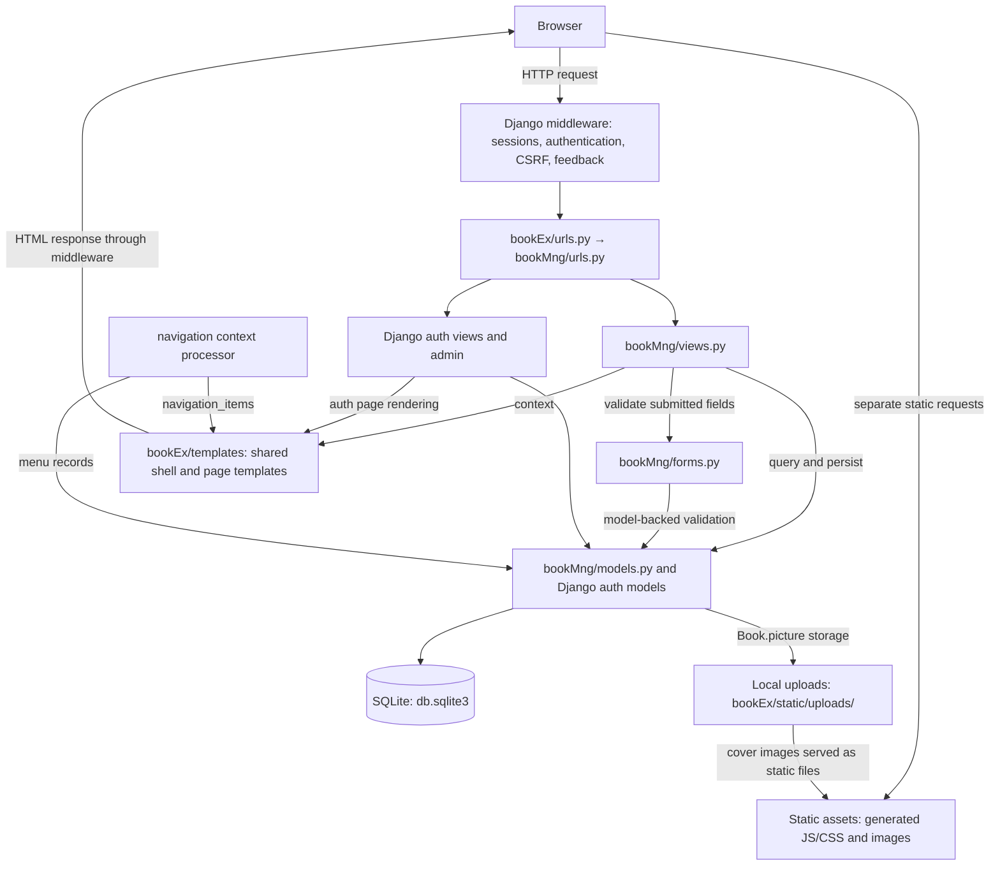
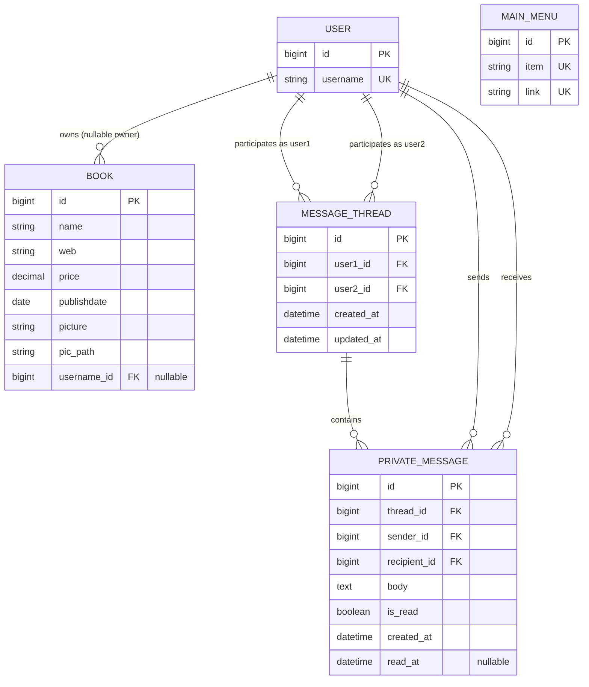
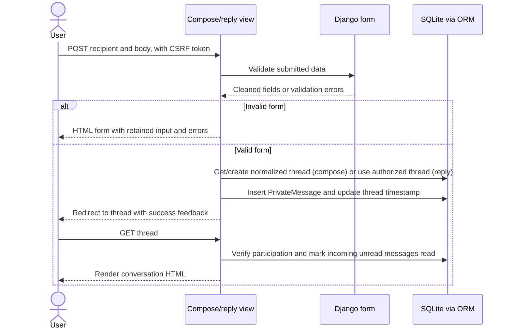
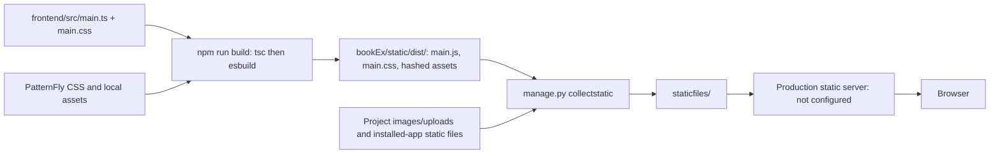

q# Book Exchange architecture

This document describes the implementation in this repository as reviewed on
November 16, 2026. It covers the application structure, request and data flows,
frontend build, and current architectural limitations. See [README.md](README.md)
for detailed setup and operation instructions.

## Overview

Book Exchange is a server-rendered Django monolith. One application, `bookMng`,
implements book listings, search, and private messaging. The `bookEx` project
provides configuration, root routing, templates, and static assets. Django's
built-in applications provide accounts, sessions, administration, and feedback
messages.

The application follows Django's model-template-view pattern: URL patterns select
views, views validate forms and query models through the ORM, and templates render
HTML. Business logic lives in views and model helpers; there is no separate service
or repository layer. Browser interactions use ordinary links and HTML forms.
TypeScript provides progressive enhancement. There is no application JSON API,
client-side router, background worker, or real-time messaging transport.

Static serving depends on the environment: Django's development server discovers
source assets locally; a production static server still needs to be configured.
Django admin uses its own templates rather than the application's shared shell.

## Source map

| Location | Responsibility |
| --- | --- |
| `manage.py` | Django management entry point: development server, migrations, checks, and tests. |
| `bookEx/settings.py` | Installed applications, middleware, template processors, SQLite, and static paths. |
| `bookEx/urls.py` | Mounts admin, application routes, registration, and built-in authentication routes. |
| `bookEx/wsgi.py`, `bookEx/asgi.py` | Server entry points for hosting Django. |
| `bookMng/urls.py` | Routes for listings, search, and messaging. |
| `bookMng/views.py` | Request handling, permissions, search queries, persistence, and template selection. |
| `bookMng/forms.py` | `BookForm`, `ComposeMessageForm`, and `ReplyForm`. |
| `bookMng/models.py` | Menu, book, thread, and message models and related helpers. |
| `bookMng/context_processors.py` | Shared navigation for application and authentication templates. |
| `bookMng/admin.py` | Registers all four application models with Django admin. |
| `bookMng/migrations/` | Schema history: menu, then books, then messaging. |
| `bookEx/templates/` | Base layout, reusable includes, application pages, and account templates. |
| `frontend/src/` | TypeScript behavior, PatternFly imports, and application CSS. |
| `frontend/build.mjs` | esbuild configuration and generated-output cleanup. |
| `frontend/package.json`, `frontend/package-lock.json` | Frontend commands and dependency declarations/resolution. |
| `frontend/tests/forms.mjs` | Browser checks invoked by the Django browser test harness. |
| `bookEx/static/` | Source images, legacy uploads, and generated `dist/` bundles. |
| `staticfiles/` | Ignored output of `collectstatic`; generated deployment assets. |
| `db.sqlite3` | Local database, ignored by Git. |

## Routes and access boundaries

Paths below preserve the current mixture of routes with and without trailing slashes.

| Path | Handler or feature | Current access and behavior |
| --- | --- | --- |
| `/`, `/about/` | `index`, `about` | Public informational pages. |
| `/search/` | `search_books` | Public search by title or seller username. |
| `/book_detail/<book_id>` | `book_detail` | Public book details; missing records return 404. |
| `/displaybooks` | `displaybooks` | Login required; displays all books. |
| `/postbook` | `postbook` | Login required; GET form, POST listing with file upload. |
| `/mybooks` | `mybooks` | Login required; filters listings to the current user. |
| `/book_delete/<book_id>` | `book_delete` | Immediately deletes the record; currently lacks login, ownership, and HTTP method checks. |
| `/inbox/` | `inbox` | Login required, GET only; lists the user's conversations. |
| `/compose/` | `compose_message` | Login required, GET/POST; creates a message to another user. |
| `/thread/<thread_id>/` | `thread_detail` | Login and participation required, GET/POST; reads messages and accepts replies. |
| `/thread/<thread_id>/mark-read/` | `mark_thread_read` | Login and participation required, POST only. |
| `/register`, `/register/success` | `Register`, `TemplateView` | Public registration through Django's `UserCreationForm` and success page. |
| `/login/`, `/logout/`, other built-in auth paths | Django authentication views | Session-based authentication; the shell submits logout through a CSRF-protected POST. |
| `/admin/` | Django admin | Staff access governed by Django admin permissions. |

`LOGIN_URL` resolves the named `login` route. Protected views redirect visitors
there with a `next` destination. Middleware supplies the authenticated user and
CSRF protection; individual views implement object-level authorization.

## Data model

The diagram shows selected user fields; Django owns the complete account schema.
The book owner relationship is optional: a book may have no user, while every
non-null owner reference identifies one user. All application foreign keys use
`CASCADE`, so deleting a user also removes their associated books, threads, and
messages. Deleting a thread removes its messages. `MainMenu` is independent of
the other application entities.

- **Book:** `username` is the owner foreign key despite its name. `picture` stores
  a file reference; file contents live on disk. `publishdate` uses `auto_now=True`,
  so saving a book updates it. List views assign a derived `pic_path` in memory;
  search and detail views instead use `_book_cover_url()`.
- **MessageThread:** a unique database constraint covers `(user1, user2)`.
  `get_or_create_thread()` orders users by primary key and rejects self-messaging,
  giving the normal application flow one conversation per pair. The database
  itself does not enforce that ordering or reject identical participants.
- **PrivateMessage:** records sender, recipient, body, and read state.
  `mark_as_read()` sets both `is_read` and `read_at`. Consistency between message
  participants and thread participants is enforced by the sending views rather
  than a database constraint.
- **MainMenu:** stores unique labels and destinations. Known legacy destinations
  resolve to named routes; custom relative paths are anchored at the home URL.

## Main request flows

### Posting and finding books

1. An authenticated user submits the multipart post-book form.
2. `BookForm` validates `name`, `web`, `price`, and `picture` using the model fields.
3. The view assigns the current user as owner and saves the book through the ORM;
   file storage writes the upload separately from the SQLite record.
4. The response redirects to `/postbook?submitted=True` to display confirmation.

Search accepts `q`, `sort`, and `page` query parameters. It trims the query and
matches title or seller username case-insensitively. Blank queries return no
results. Sorting supports newest, price ascending/descending, and title, with a
stable primary-key tie-breaker. Invalid sort values fall back to newest. Django's
`Paginator` returns 12 results per page, and `select_related('username')` fetches
owners alongside results. Detail and search pages resolve legacy uploaded covers
through the configured static URL.

### Private messaging

Compose excludes the current user from selectable recipients. A GET `user_id`
parameter can preselect a recipient; POST validation uses the submitted value.
Thread access and explicit mark-read actions return 404 for nonparticipants.
Inbox results are scoped to the current user and sorted by thread `updated_at`;
messages are ordered by creation time. Opening a thread marks incoming messages
read, so GET currently changes read state. New messages appear after another page
request; no polling or WebSocket client is implemented.

## Presentation and frontend build

`base.html` loads `dist/main.css` and the `dist/main.js` ES module, and supplies the
masthead, navigation, account actions, feedback, main landmark, and footer.
Page templates extend it. Shared includes render form fields, error summaries,
message forms, and Django feedback messages.

The navigation context processor queries `MainMenu`, supplies default links when
the table is empty, ensures Home appears first exactly once, and calculates
current-page state. It also runs for built-in authentication pages using the
configured template backend. Several views still pass legacy `item_list` context.

The frontend uses PatternFly 6.7.0 CSS with native HTML controls. TypeScript handles
responsive navigation, keyboard/focus behavior, and focusing server-rendered form
errors. Django remains responsible for form validation and persistence; forms and
messaging work with JavaScript disabled.

esbuild targets ES2022 and emits minified production bundles. Watch mode emits
source maps and requires a separate typecheck watcher. Each build/watch startup
clears only `bookEx/static/dist/`. Node is a build-time dependency; Django serves
the application at runtime. Generated bundles, `node_modules/`, and `staticfiles/`
are ignored by Git.

## Persistence and deployment boundaries

The configured database is the local `db.sqlite3` file. Migrations describe the
application schema; Django also manages account, session, and admin tables.
Uploads go to `bookEx/static/uploads/` through `Book.picture`. There is no
dedicated media-storage configuration, external database, cache, or job queue.

`STATICFILES_DIRS` points to `bookEx/static/`, `STATIC_ROOT` to `staticfiles/`, and
`STATIC_URL` to `/static/`. Building the frontend and collecting static files are
separate steps. A one-time collection includes existing uploads but does not
publish later uploads automatically.

WSGI and ASGI entry points are provided, but the repository does not configure a
production application server, static server, hosting platform, or production
settings module. The current settings enable debug mode, leave allowed hosts
empty, and embed a development secret key. These settings describe the local
development configuration.

## Verification and current limitations

Existing verification is organized as follows:

| Source or command | Coverage or purpose |
| --- | --- |
| `bookMng/tests.py` | Login redirects, owner-filtered listings, shared navigation, forms, CSRF, uploads, and optional browser integration. |
| `bookMng/test_search.py` | Search matching, sorting, pagination, escaping, cover URLs, and detail pages. |
| `bookMng/test_messaging.py` | Compose/reply validation, thread permissions, read state, escaping, feedback, and CSRF. |
| `frontend/tests/forms.mjs` | Browser journeys with and without JavaScript, launched by Django tests. |
| `python manage.py check` | Django configuration checks. |
| `python manage.py test` | Server regression suite; browser cases are opt-in. |
| `BOOKEX_BROWSER_TESTS=1 python manage.py test bookMng.tests.PatternFlyBrowserTests` | Browser integration; requires built assets, Node, and Chrome/Chromium. |
| `npm run build` in `frontend/` | TypeScript checking and asset compilation. |

This architecture review inspected source and configuration; it did not execute
the application or rerun these test suites.

Current implementation gaps relevant to future changes:

- **Deletion permissions:** `book_delete` deletes on GET and performs no login or
  ownership check. The owner-filtered My Books page does not secure that endpoint.
- **Python dependency reproducibility:** no Python dependency manifest or lockfile
  is committed. `bookMng/forms.py` also imports `conda.notices.fetch` without using
  it, creating an incidental import-time dependency beyond Django.
- **Upload lifecycle:** uploads share the static source tree. Persistent upload
  storage and serving need an explicit deployment arrangement separate from
  rebuilding and collecting assets.
- **Messaging consistency:** message creation and thread timestamp updates are
  separate writes without an explicit transaction. Participant invariants depend
  on application helpers and views.
- **Query scaling:** inbox rendering calls per-thread helpers for latest messages
  and unread counts; the filtered/ordered related queries can still issue extra
  SQL despite prefetching. Navigation also queries menu records during rendering.
- **Asset caching:** `main.js` and `main.css` have stable filenames; deployments
  need revalidation or cache invalidation for those entry files. Referenced assets
  use hashed filenames.

These are observations about the current implementation, not changes made as part
of this documentation.
